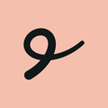
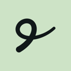

  
  <h1>Blyglet</h1>
  
A little iPhone app for posting to your blyg.

  <a class="button" href="https://testflight.apple.com/join/HER7EwkZ">Join the beta on TestFlight</a>
  
Free while in testing · iPhone, iOS 18 or later

<ul class="sticker-sheet" aria-label="The app icons. Each one sets this page's icon and colors.">
  <li style="--x:0%;--y:4px;--r:-8deg;--z:4;--ny:6px;--nr:-8deg"><button type="button" class="sticker" data-icon="paper" data-palette="blue" data-mode="light" title="Paper, always light" aria-label="Paper, always light">☀︎</button></li>
  <li style="--x:24%;--y:0px;--r:7deg;--z:5;--ny:0px;--nr:6deg"><button type="button" class="sticker" data-icon="ink" data-palette="blue" data-mode="dark" title="Ink, always dark" aria-label="Ink, always dark">☾︎</button></li>
  <li style="--x:28%;--y:76px;--r:-4deg;--z:20;--ny:10px;--nr:-4deg"><button type="button" class="sticker" data-icon="pencil-blue" data-palette="blue" title="Pencil blue"></button></li>
  <li style="--x:0%;--y:86px;--r:6deg;--z:6;--ny:2px;--nr:10deg"><button type="button" class="sticker" data-icon="piglet-pink" data-palette="pink" title="Piglet pink"></button></li>
  <li style="--x:52%;--y:164px;--r:-5deg;--z:11;--ny:8px;--nr:-11deg"><button type="button" class="sticker" data-icon="coral" data-palette="pink" title="Coral"></button></li>
  <li style="--x:50%;--y:10px;--r:-7deg;--z:3;--ny:0px;--nr:5deg"><button type="button" class="sticker" data-icon="sky" data-palette="blue" title="Sky"></button></li>
  <li style="--x:54%;--y:84px;--r:11deg;--z:7;--ny:12px;--nr:-6deg"><button type="button" class="sticker" data-icon="pink-on-white" data-palette="pink" title="Pink on white"></button></li>
  <li style="--x:6%;--y:160px;--r:-9deg;--z:9;--ny:4px;--nr:9deg"><button type="button" class="sticker" data-icon="warm-pink" data-palette="pink" title="Warm pink"></button></li>
  <li style="--x:30%;--y:152px;--r:13deg;--z:10;--ny:6px;--nr:-3deg"><button type="button" class="sticker" data-icon="blue-pink-curl" data-palette="blue" title="Blue, pink curl"></button></li>
  <li style="--x:72%;--y:2px;--r:10deg;--z:2;--ny:0px;--nr:12deg"><button type="button" class="sticker" data-icon="moss" data-palette="moss" title="Moss"></button></li>
  <li style="--x:74%;--y:156px;--r:7deg;--z:12;--ny:10px;--nr:-9deg"><button type="button" class="sticker" data-icon="blue-coral-curl" data-palette="blue" title="Blue, coral curl"></button></li>
  <li style="--x:75%;--y:80px;--r:-10deg;--z:8;--ny:2px;--nr:4deg"><button type="button" class="sticker" data-icon="butter" data-palette="butter" title="Butter"></button></li>
</ul>

Paper ☀︎ and Ink ☾︎ also set light or dark, until you pick another sticker or press ◐.

Blyglet is for [Blygger](https://blygger.org) blygs. It does a few things well, so you can post from anywhere and get back to your day:

- **Post** text, a link or a photo to your blyg in a couple of taps.
- **Share** from any app, with "Post to blyg" in the Share sheet.
- **Reply** to any blyg post, from whichever of your blygs you choose.
- **Read** the blygs you follow, with the posts they quote and link to. Refreshing runs in the background, and posts come in blyg by blyg.
- **Catch up** on the last two weeks: the feed shows up to 200 posts, and older ones are under **All posts** on each blyg's page.
- **Keep in step** with the blygs your Studio follows. One that can't be reached gets two more tries, on later launches.
- **Make it yours** with color themes and icons. Try them: tap a sticker at the top.

Pencil blue is the default, and the only one with dark and tinted versions.

Blyglet does quick posts and replies. For editing, threads with quotes, pins and the rest, it opens your blyg's Studio.

## What you need

- **To read:** nothing. Add any blyg by its address; Blyglet reads its public files.
- **To post:** a blyg run on [Blygger Studio](https://github.com/blygger/blygger-studio), at an https address. In its Studio, go to **More → Client access**, create a **REST API** token with the read, draft and publish permissions, and paste it into Blyglet (Your blygs → your blyg). The token stays in your phone's Keychain and goes only to your blyg, never in the clear. Tokens last 30 days.

Blyglet collects nothing about you and runs no servers. See the [privacy policy](privacy.html).

<h2 id="support">Support</h2>

Found a problem or have a question? [Open an issue on GitHub](https://github.com/djinna/blyg-ios/issues), or use **Send Beta Feedback** in the TestFlight app.

Things worth knowing:

- **A post looks wrong.** Blyglet shows each post's HTML as its blyg published it. If it looks wrong on the blyg's own web page too, it's the post, not the app.
- **"Didn't accept the token."** Manual tokens expire after 30 days. Make a new one in Studio and connect again.
- **Unfollowing** removes a blyg and its saved posts from your phone, plus any token for it. Nothing changes on the blyg.
- **The version** is in Settings → About. Please include it when you report a problem.

Blyglet was called Blyg until 2026-11-22; only the name changed. Its source code is at [github.com/djinna/blyg-ios](https://github.com/djinna/blyg-ios).
